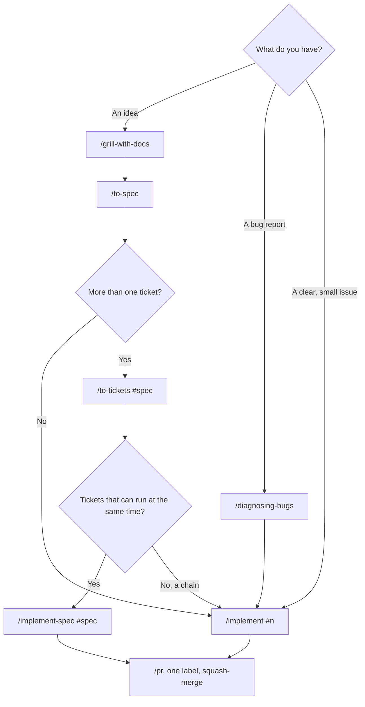

# Workflow

How we take work from an idea or a bug report to a merged pull request, using
[Matt Pocock's skills](https://github.com/mattpocock/skills) in Claude Code. Issues and specs live
in [GitHub Issues](https://github.com/fourkitchens/ddev-fire-worktrees/issues). `ready-for-agent`
marks an issue an agent can pick up.

Skills that don't start on their own run only when you type their slash command.

## Pick a path



## New feature

```
/grill-with-docs          talk it through until the design is settled
      │                   (writes GLOSSARY.md and docs/adr/ as decisions firm up)
      ▼
/to-spec                  spec issue on GitHub, labelled ready-for-agent
      │
      ▼
/to-tickets #12           sub-issues #13 #14 #15, with blocking links
      │
      ▼
/implement-spec #12       all tickets → one branch → /code-review → draft PR
   or /implement #13      one ticket at a time
```

Optional: `/prototype` to try a design, `/research` to check a fact before you write the spec.

## Reported issue

```
gh issue view 42 --comments
      │
      ├─ bug?          /diagnosing-bugs  →  /implement #42   (failing bats test first)
      ├─ clear, small  /implement #42
      └─ vague, large  /grill-with-docs  →  /to-tickets #42  (sub-issues of #42)
```

Put `Closes #42` in the pull request.

## `/implement` or `/implement-spec`?

| | `/implement #n` | `/implement-spec #spec` |
| --- | --- | --- |
| Input | One ticket or issue | A spec with tickets from `/to-tickets` |
| Agents | One, in your checkout | One per ticket, each in its own worktree |
| Output | Commits on the current branch | One branch, draft PR closing the spec and tickets |
| Use for | Bugs, small changes, chains of tickets | Three or more tickets, some independent |

With `/implement-spec`:

- Tell it to run `tests/lib.bats` and `tests/create.bats` for each ticket, and the full suite once
  at the end. Every DDEV test starts real projects, so several agents running the suite at once
  slows the machine.
- The feature lands as one squash commit with one label. Split mixed work, such as a `bug` fix
  inside an `enhancement`, into separate pull requests.
- Run `ddev fire-worktree-prune` afterwards to remove DDEV projects its worktrees left behind.

## Every pull request

```
/code-review   →   /pr   →   one label   →   CI green   →   squash-merge
```

Labels, CI and releases: see [Contributing](contributing.md).

## Now and then

| Skill | When |
| --- | --- |
| `/retro` | After a rough session: it suggests better checks, standards and agent instructions |
| `/improve-codebase-architecture` | Before a big feature: it finds refactors that make the change easier |
